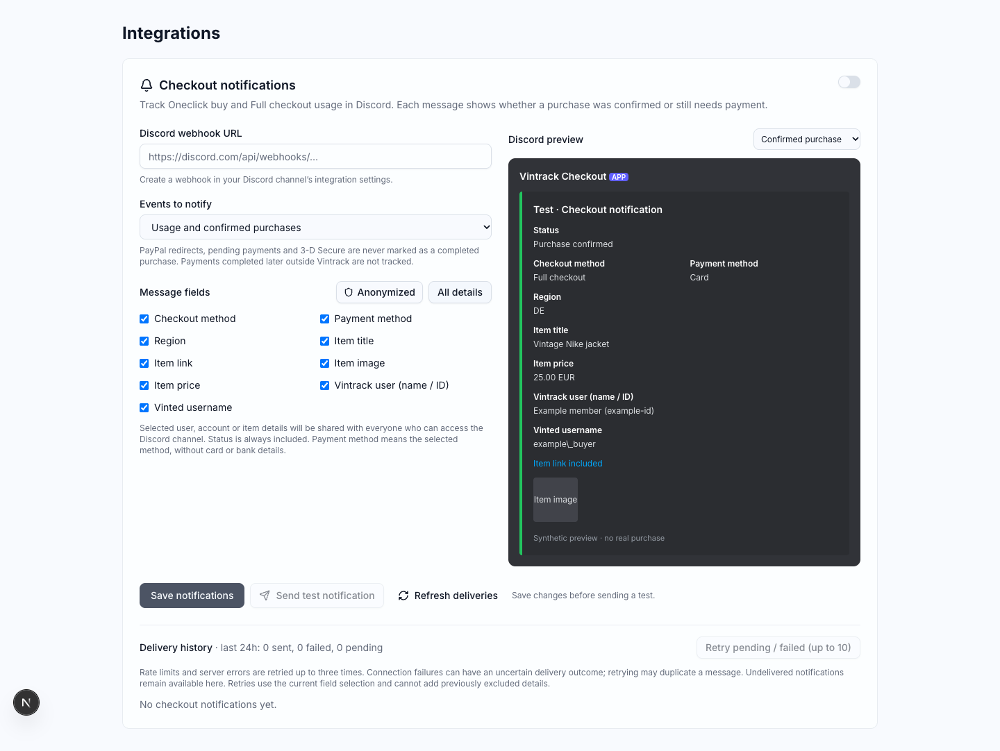
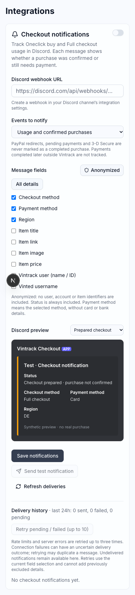

# Admin checkout notifications

Configure the global Discord destination under **Admin → Integrations →
Checkout notifications**. Notifications are disabled by default. Enter a Discord
channel webhook, choose fields, enable notifications and save. A saved URL is
never returned to the browser; a blank replacement keeps the existing URL.
The test button sends a synthetic message using the saved configuration.

The **Anonymized** preset includes checkout method, selected payment method,
region and status. **All details** adds item title/link/image, item price,
Vintrack member name/ID and Vinted username. Every optional field can be toggled
independently. Status is mandatory so a prepared checkout cannot look like a
confirmed purchase. No email, address, card/bank details, checkout URLs, payment
redirect tokens or session credentials are included. Item price is the catalog
price, not the final paid total with shipping and fees.

Both the server checkout path and the extension result stored by the dashboard
feed notifications. Oneclick means preparing the checkout; Full checkout means
the auto-checkout option was enabled. The legacy buy test endpoint also reports
its result, with the payment choice labeled as Vinted because it accepts opaque
Vinted payment selections.

**Usage and confirmed purchases** reports prepared checkouts, manual review,
PayPal/payment redirects, pending card payments, authentication challenges,
failed payments and unknown outcomes with distinct status labels. **Confirmed
purchases only** accepts the explicit `card_payment_confirmed` result. Browser
results are reported by the linked extension, not independently verified against
Vinted orders. Later completion in PayPal, 3-D Secure or the native Vinted page
is not tracked by these existing flows, so it cannot produce a later confirmed
purchase notification automatically.

## Delivery

The dashboard persists only the selected Discord payload and schedules delivery
after its HTTP response with Next.js `after()`. A database claim prevents repeated
reports for the same checkout. Each checkout can produce one activity message
and, if later observed by Vintrack, one confirmed purchase message. An already
confirmed checkout cannot be downgraded by a replayed review result. Notification
errors never change the checkout response or repeat a payment operation.

Discord requests use `wait=true`, disable mentions and refuse HTTP redirects,
following the [Discord webhook API](https://docs.discord.com/developers/resources/webhook#execute-webhook).
Rate limits and server errors receive up to three attempts; long rate-limit waits
are retained as failed deliveries. An uncertain transport failure is not retried
automatically because the message may already exist. Pending/failed deliveries
are retained for the admin retry button, which processes up to ten at a time.
This also recovers pending rows after a process restart; there is no scheduled
background drain. Manual retries of an uncertain delivery may duplicate a message.
Retries respect the current event filter and can only remove fields from the
original payload, never add previously excluded data.

The admin view shows recent outcomes, delivery status, attempt counts, sanitized
errors and delivery totals from the past 24 hours. Payloads and webhook tokens
are excluded from admin snapshots and audit metadata.

## Deployment and validation

Apply the new migration before serving the updated Integrations page:

```sh
cd apps/control-center
npx prisma migrate deploy
npx prisma generate
```

The migration creates `checkout_notification_deliveries`; configuration uses
the existing `app_settings` table. No new environment variables are required.

Validation uses synthetic account/item responses and mocked Discord requests:

```sh
cd apps/control-center
npm run test:unit
npm run lint
npm run build
```

The desktop and mobile images below were captured from the actual component with
synthetic state, without changing database settings or sending Discord messages.



