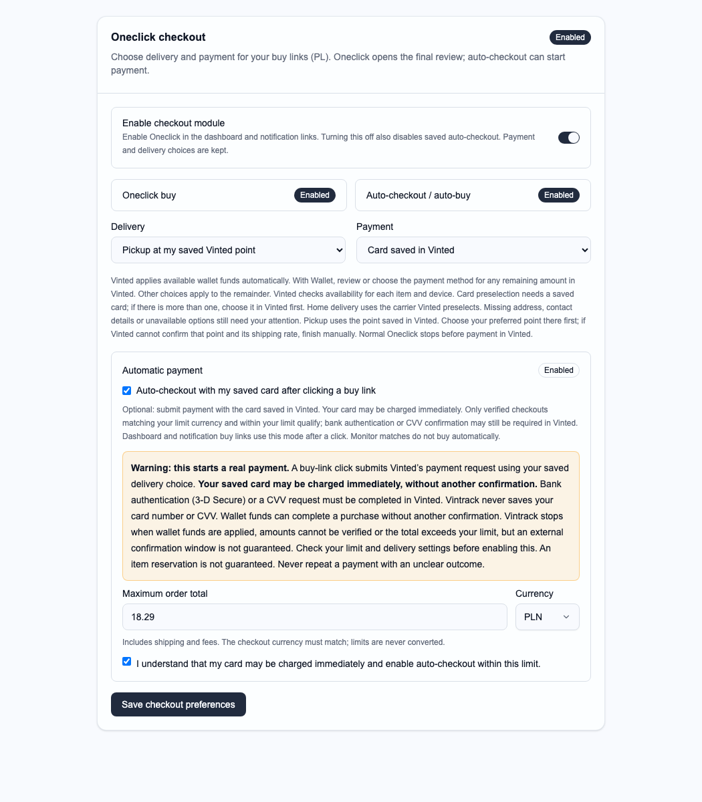
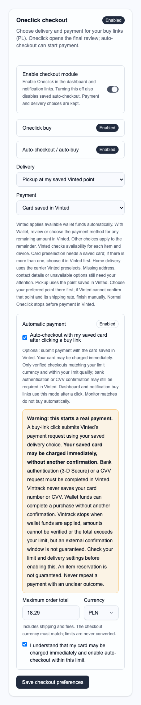
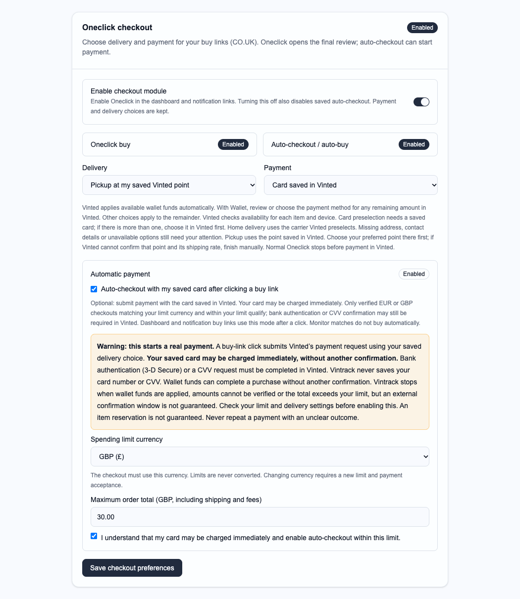
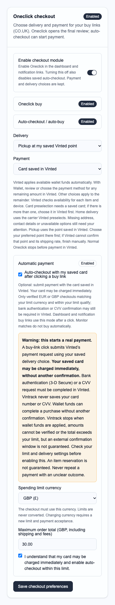

# Saved pickup points and checkout currencies

Date: 13 October 2026. All currencies require extension **0.4**, preparation
protocol **8**. EUR/GBP pickup retains protocol 7 compatibility (0.3.4).

Account → Oneclick checkout → Delivery now offers **Pickup at my saved Vinted
point**. Choose the preferred point in Vinted first. Vintrack selects the point
Vinted supplies for the current checkout using its UUID, code and carrier rate.
The final response must confirm pickup type 2, the same point UUID/code, and a
selected rate matching both the shipping point and carrier option. A valid
address and any required phone number are also checked. No nearby-point search
or arbitrary fallback point is used.

If the build includes the point, it is included in the existing quote update.
If switching to pickup reveals it, one extra update explicitly confirms that
point. Missing/changed points, inconsistent rates or missing contact details
stop automatic payment and leave Vinted for manual completion. Normal Oneclick
can also prepare pickup but always stops before payment.

Auto-checkout spending limits now support **all current ISO currency/fund codes
with numeric minor units**, including shipping and fees. New drafts use the
linked region's currency (EUR, GBP, PLN, CZK, SEK, DKK, RON, HUF or USD);
existing settings retain their
original currency. Changing the limit currency clears the draft amount and
requires a fresh payment-warning acceptance before saving. Changing delivery
also requires acceptance again when auto-payment is enabled. Existing EUR
limits are never converted or applied to GBP quotes.

The final total and every wallet-deduction amount must use the exact limit
currency. Wallet deductions must be zero; conversion, unknown deductions,
missing totals/checksums, or exceeded limits still stop payment. Saved-card
auto-checkout supports UK GBP quotes. PayPal retains its DE/AT/BE regional
restriction; GBP support does not introduce UK PayPal.

Old extensions are blocked before readiness, the shared payment claim, or any
Vinted mutation when unsupported currency/pickup settings are requested. Existing EUR home-delivery
protocols remain compatible. Switching currency/delivery does not reset local
or server attempt locks and cannot replay a payment.

No schema or new environment variable is needed. The existing account/domain
scoped preferences JSON stores the new delivery option and currency. Both
manifests, `.env.example`, Compose and the dashboard latest-version fallback
are 0.4. A configured GitHub `BROWSER_EXTENSION_LATEST_VERSION` must match
before release. Reload development extensions and open Vintrack/Vinted pages
after installing the new package.

## Currency data and exact amounts

The reviewed [SIX ISO 4217 List One](https://www.six-group.com/dam/download/financial-information/data-center/iso-currrency/lists/list-one.xml)
(published 17 September 2026, retrieved 13 October 2026 over HTTPS, HTTP 200 XML)
supplies 165 codes with numeric minor units. The snapshot is checked into
`data/checkout-currencies.json`; `python3 scripts/generate-checkout-currencies.py`
generates offline tables for dashboard, Go service, and both extension contexts.
`--check` detects drift. Extension validation also compares all four runtime
tables with the snapshot. Updating the registry requires reviewing the new
source data and rerunning generation/validation; production does not fetch it.

JPY has zero decimal places, PLN two, KWD three and CLF four. Saved limits and
quote amounts use those units consistently. Extra decimals are accepted only
when every excess digit is zero (e.g. `18.00 JPY` = 18 yen); nonzero excess
precision, exponents, negative values and ambiguous formats are rejected.
The maximum configurable limit is 10,000 major units of the selected currency,
scaled to its units. It is not an exchange-rate conversion. Codes without
defined numeric minor units (including XXX), unknown codes and cryptocurrency
tickers do not authorize payment.

Supporting a code does not add a Vinted region or payment provider. The current
Vinted quote must actually use that code and offer an enabled saved card or
regionally permitted PayPal. Changing currency clears the draft amount and
acceptance, and never resets payment-attempt locks.

## Read-only recon evidence

Target: native web-checkout field contracts, without account authentication.
Bounded GET requests via Scrapling inspected the two public bundles below;
both returned HTTP 200 at the requested URL. No reusable session or browser
was opened. Bodies were JavaScript, not challenge pages. The MCP output did
not report content-type/response headers or TLS profile. Targeted excerpts
were inspected locally in the tool orchestrator; credentials were never used.

- [Checkout UI bundle](https://marketplace-web-assets.vinted.com/_next/static/chunks/36m0sy627sdj1.js): native Home=1 and Point=2; point response fields `uuid`, `code`, `rate_uuid`; shipping option `rate_uuid`; `selected_rate_uuid`; required-contact fields.
- [Checkout API bundle](https://marketplace-web-assets.vinted.com/_next/static/chunks/0ym25ppuz24ui.js): PUT `/purchases/{id}/checkout` serializes `shipping_pickup_options.pickup_type` and `shipping_pickup_details.rate_uuid`, `point_code`, `point_uuid`.

Observed: native selection uses the point's identifiers with its carrier rate.
Inference: a point provided by the current native checkout can be reused as the
saved delivery choice. Whether every region restores the saved point when
switching delivery is not live verified; absence leaves manual review. Bundle
filenames/contracts can change. No access denial or rate limit was encountered.

Recommendation: keep request preparation in the existing browser bridge/service,
using only fields from the current checkout; no authenticated scraping needed.

## Validation

Synthetic Go and extension tests cover explicit point selection in build and
after switching, missing/changed points, mismatched carrier/selected rates,
address/contact failures, manual checkout stopping before payment, GBP limits,
cross-currency quotes/deductions, conversion and replay prevention across changes.
Dashboard tests cover saving GBP/pickup preferences and old-extension rejection
before readiness/authorization on desktop and mobile.

The current currency extension passed service `go test ./...`, 227 dashboard
unit tests, dashboard lint/production build, 78 extension validation tests and
Chrome/Firefox package builds. Synthetic payment tests cover exact and exceeded
limits for every registered currency, as well as zero/two/three/four-decimal
precision. All 52 checkout browser tests passed (26 desktop + 26 mobile,
bundled Chromium), covering protocol compatibility for PLN and EUR/GBP pickup.

Isolated UI checks rendered the real account component with synthetic UK
settings and stubbed actions on desktop and mobile: pickup/GBP controls were
visible, no horizontal overflow occurred, and changing currency cleared the
amount/acceptance. Saving stayed disabled until a new amount and acceptance;
the saved payload retained the exact chosen currency. Delivery changes also
cleared acceptance. No member settings were changed by these checks.

The currency picker is now a compact 96-pixel button beside the amount. Its
popover shows the selected currency and common Vinted-region currencies;
search reaches every registered code while showing at most nine results.
Unknown searches and cancelling do not change the saved/draft limit; selecting
a different currency still clears the amount and acceptance. Selecting the
same currency preserves them. Arrow keys, Enter and Escape are supported.

Isolated desktop/mobile checks passed for compact width, bounded results,
search/keyboard selection, invalid-search isolation and exact JPY/KWD limits.
No horizontal overflow occurred. Four PLN handoff browser tests passed with
the new 0.4 update message, as did lint, production build and extension validation/
package builds. No account settings were changed by the UI checks.

No live checkout, payment request or purchase was executed. Real UK GBP payment
and saved pickup restoration remain unverified against an authenticated account.
Additional currencies likewise have synthetic contract coverage rather than
live payment confirmation.
