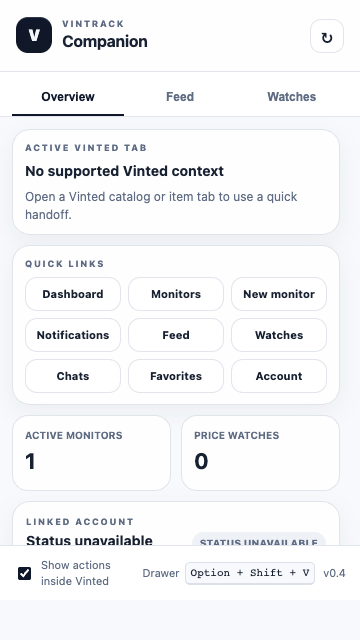
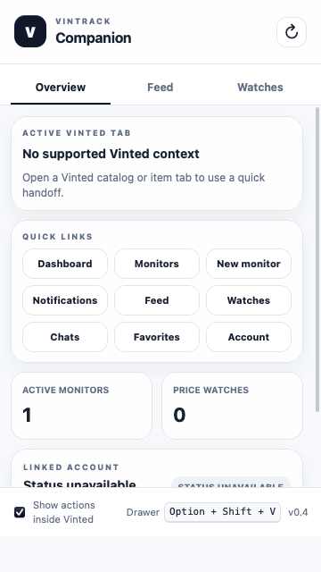

# Mobile Oneclick checkout previews

Android Firefox and iPhone Safari now have separate development builds. These
are **unreleased previews**, not a claim that checkout has been verified on a
phone. The existing Chrome and listed Firefox release manifests are unchanged.
No account linking, live checkout, or payment was performed for this work.

The [REA checkout reconstruction](checkout-rea-2026-10-17.md) records the
public shipped-code evidence and resulting protocol fixes. Extension detection
and the mobile auto-payment gate are implemented. The
[architecture review and device test plan](mobile-checkout-review-2026-10-16.md)
still identifies multiple paired devices and resumable handoff as additional
work before a general mobile beta.

## Common flow

Sign in to Vintrack and Vinted in the same mobile browser and connect that
browser in Vintrack Account. Enable the checkout module with the existing
consent flow. Open alert links in that browser using Telegram/Discord's
external-browser action; their embedded browsers do not provide our extension.
Signing in to the Vinted native app does not sign in to the browser.
Explicit mobile connection/sync actions activate Vinted for account detection;
return to Vintrack afterward to review the connection. Automatic maintenance
does not bring Vinted to the foreground.

The existing extension bridge verifies the linked account and prepares checkout
inside a same-region Vinted page. Mobile receivers are activated before
preparation, and newly created Vinted tabs open in the foreground. Restoring a
discarded tab waits for its bridge before recording an attempt. Disconnected
complete tabs still require a manual reload. Completed and uncertain attempts
retain the existing replay protection, including after extension restarts.

Normal Oneclick ends at Vinted's payment confirmation. Mobile previews advertise
`automaticPayment=false` and reject automatic payment before readiness,
server-side payment claims or checkout mutations. If desktop auto-payment is
enabled in Account, turn it off before using mobile normal Oneclick. PayPal,
saved-card payments and 3-D Secure are not verified on either mobile browser.

The dashboard waits up to three seconds for a correlated extension response,
repeating only non-mutating pings. Missing, unconfigured or outdated receivers
show setup/update guidance. An absent response never starts server checkout.
Once normal preparation is dispatched, the extension owns the Vinted request
and navigation; it does not depend on another dashboard step after tab switching.
This does not prove survival of an iOS background-process termination.

## Build both previews

From the repository root:

```sh
bash apps/vintrack-browser-sync-extension/scripts/build-packages.sh --mobile-previews
```

This generates the ordinary desktop packages plus:

- `apps/vintrack-browser-sync-extension/dist/firefox-android`: unsigned Firefox
  Android preview, minimum Firefox 142 (built-in data collection consent).
- `apps/vintrack-browser-sync-extension/dist/safari`: Safari preview source,
  minimum Safari/iOS 18. Earlier Safari cookie APIs cannot retrieve HttpOnly
  cookies, which can be needed for browser session sync.

Use `--android-preview` or `--safari-preview` to prepare only one extra target.
No new origins, cookie export, refresh-token storage or backend endpoints are
introduced. Generated manifests retain the production origin allowlist. For
self-hosted domains, apply the existing custom-origin procedure to each preview.
The release workflow continues to submit only the regular Firefox build; CI
also builds both preview manifests and lints the Android target.

## Android development install

Install Android Platform Tools (`adb`), connect a phone with USB debugging,
enable Firefox's remote debugging setting and confirm it appears in
`adb devices`. With the preview built:

```sh
npx --yes web-ext@10 lint --source-dir apps/vintrack-browser-sync-extension/dist/firefox-android
npx --yes web-ext@10 run --source-dir apps/vintrack-browser-sync-extension/dist/firefox-android --target firefox-android --firefox-apk org.mozilla.firefox --adb-device DEVICE_ID
```

Replace `DEVICE_ID` with the intended device. This is a developer installation,
not a signed end-user package. Accept the requested site/data permissions and
connect the extension from Vintrack in Firefox. AMO Android availability should
only be enabled after device validation; the listed release currently has no
Android compatibility declaration.

## iPhone development install

For local debugging, use the Xcode path below. Apple also provides
[App Store Connect packaging](https://developer.apple.com/documentation/safariservices/packaging-and-distributing-safari-web-extensions-with-app-store-connect)
for uploading extension resources and distributing the packaged extension with
TestFlight without local Xcode. That path requires Apple Developer Program
membership and appropriate App Store Connect access; it does not replace real
iPhone runtime testing. No upload or store submission has been performed.

Install full Xcode with the iOS SDK and select it as the active developer tools.
Then run:

```sh
bash apps/vintrack-browser-sync-extension/scripts/create-safari-project.sh
```

The script uses Apple's `safari-web-extension-packager` (or its older
`safari-web-extension-converter` name) to create an iOS-only Xcode project in
`apps/vintrack-browser-sync-extension/dist/safari-ios-project`. It copies the
preview resources and refuses to overwrite an existing project. An optional
directory argument lets you preserve a customized project while creating a new
one. After changing extension source, create a fresh project or update the copied
resources in the existing one before testing.

Open the generated project in Xcode, set your signing team and an available
bundle identifier for the containing app and extension, and run on an iPhone
with iOS 18 or newer. Enable the extension in Safari and allow access to
Vintrack and the selected Vinted region. TestFlight/App Store distribution
requires signing and the normal Apple submission process.

Safari extension pages are authorized by their own `runtime.getURL` host,
including the `safari-web-extension:` scheme; another extension's URL is rejected.
Cookie events are optional. Tab events, explicit sync and alarms remain active.
Safari session refresh stays inside an existing Vinted tab; no extension-network
fallback is attempted when that tab is unavailable. The user is asked to open
Vinted and sync again. Background timing while iOS suspends Safari is not
guaranteed.

## Verification and remaining device checks

Local checks cover generated manifests, existing session/checkout regressions,
mobile foreground activation, restoration before mutation, failed activation,
lost-response replay protection, Safari sender checks, missing cookie events,
and Safari refresh boundaries. The isolated native desktop-browser refresh
runner exercises synthetic HTTPS/cookies only. Small-viewport rendering is a
layout check, not a Firefox Android or Safari extension execution test.

Validation on 2026-10-17:

- Both preview targets build; all 100 extension tests pass, including numeric
  conversation IDs, strict transaction extraction and prevention of build after
  malformed responses.
- Firefox desktop and Android preview pass `web-ext@10 lint` with no warnings.
- Control-center: 250 unit tests, full ESLint and production build pass.
- Local checkout E2E: 56 Chromium cases (desktop and Pixel 5 emulation),
  plus 28 WebKit cases with an iPhone 13 viewport pass. These use synthetic
  account/extension/upstream responses, including delayed readiness and the
  mobile payment gate; no real Vinted checkout traffic.
- `go test ./...` and `go vet ./...` pass in `apps/vinted-service`.
- Shell/JavaScript syntax checks and `git diff --check` pass.

Additional earlier validation on 2026-10-15:

- Isolated native Chromium and Firefox HTTPS/cookie/session tests passed.
- Popup layout and tab controls pass in Chromium and Playwright WebKit at
  320×480, 360×640, 390×844 and 420×600, without horizontal overflow or a clipped
  footer. These run with synthetic extension responses.

Repeat from the repository root:

```sh
node --test apps/vintrack-browser-sync-extension/scripts/checkout.test.mjs apps/vintrack-browser-sync-extension/scripts/session-refresh.test.mjs
bash apps/vintrack-browser-sync-extension/scripts/build-packages.sh --mobile-previews
cd apps/control-center
npm run test:unit
npm run lint
npm run build
npx playwright test tests/e2e/checkout.spec.ts
```

The build needs the ordinary local example configuration and generated Prisma
client; the test run used localhost dummy values, never production secrets.
The additional WebKit run used a temporary configuration selecting WebKit and
the iPhone 13 viewport. The committed Playwright projects remain Chromium-based.




Before releasing either target, implement and verify independent device links
and recovery through mobile interruptions. Today, pairing a phone replaces the
previous browser link; the previews do not support simultaneous durable PC and
phone pairing. Then use a test account to verify linking, account
mismatch, existing/new/restored Vinted tabs, alert links opened externally,
expired sessions and mobile suspension. Obtain explicit authorization for any
live checkout test and initially stop before payment. Verify optional auto-payment
separately, including interruption/restart and provider confirmation.

On the development host used for this change, Android tools/emulator and the
Xcode Safari packager are unavailable. No APK/device run, iOS compilation,
signing, or mobile Vinted end-to-end test has been completed.

## Platform references

- [Mozilla: Android development and device testing](https://extensionworkshop.com/documentation/develop/developing-extensions-for-firefox-for-android/)
- [Mozilla: Android compatibility declaration](https://extensionworkshop.com/documentation/publish/version-compatibility/)
- [Apple: Safari extension packaging](https://developer.apple.com/documentation/safariservices/packaging-a-web-extension-for-safari)
- [Apple: Safari compatibility](https://developer.apple.com/documentation/safariservices/assessing-your-safari-web-extension-s-browser-compatibility)
- [MDN: cookie API compatibility data](https://github.com/mdn/browser-compat-data/blob/main/webextensions/api/cookies.json)
